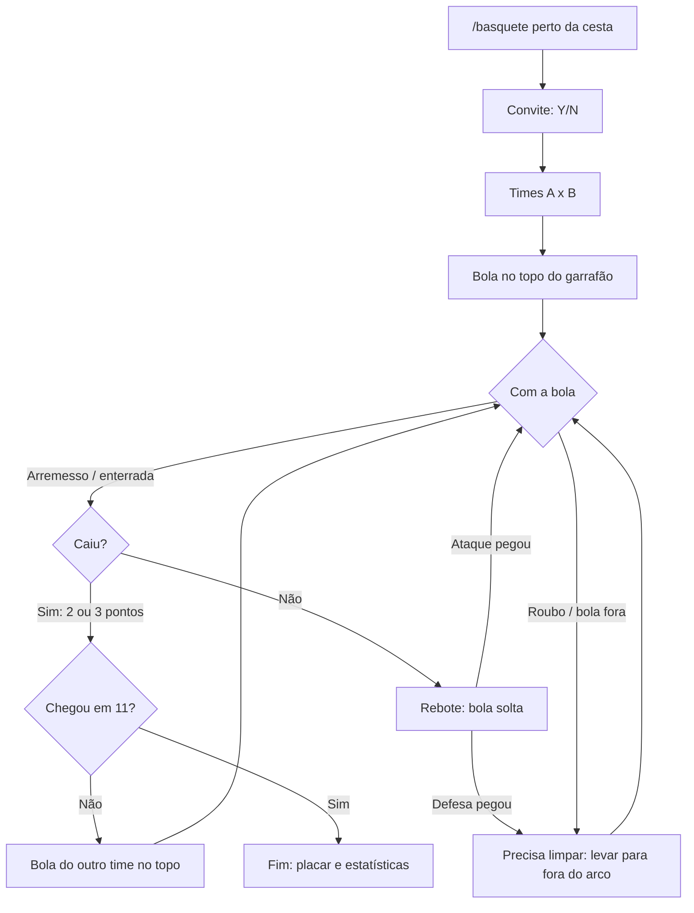

# Basquete coop: esquema

Partida de basquete entre jogadores do grupo, em qualquer cesta do mapa: 1x1, 2x2 ou 3x3, com drible, arremesso,
enterrada, roubo, toco, passe e placar na tela. O minigame original do GTA continua existindo para quem joga sozinho.

## 1. Como uma partida começa

1. Perto de uma cesta (até 15 m), alguém digita **`/basquete`** no chat (`/basquete 21` para jogar até 21,
   `/basquete treino` para treinar sozinho).
2. Quem está a até 30 m recebe o convite e aceita com **Y** (recusa com **N**), como nos outros convites do mod.
3. Depois de 15 s (ou quando todos responderem), os times são montados na ordem de entrada: A, B, A, B...
   Com 2 jogadores é 1x1, com 4 é 2x2 e com 6 é 3x3. Número ímpar: o último fica de fora e assiste.
4. O jogo de quem digitou `/basquete` é o **juiz**: ele guarda o placar oficial e resolve disputas.
5. Começa com a bola do time B no topo do garrafão.

## 2. Regras (rua, meia quadra, uma cesta)

| Regra | Como fica |
|---|---|
| Pontos | 2 de dentro do arco, 3 de fora (arco a 6 m do aro), enterrada vale 2 |
| Fim | Ganha quem chegar primeiro a 11 (ou ao número escolhido) |
| Depois de cesta | A bola vai para o outro time, no topo do garrafão (7 m do aro) |
| Limpar a bola | Depois de rebote defensivo ou roubo, o time precisa levar a bola para fora do arco antes de arremessar. A tela avisa "Limpe a bola", e um arremesso sem limpar não vale |
| Bola fora | A mais de 12 m do aro ou fora da quadra, a posse passa para o outro time |
| Sair | `/basquete sair`. Se alguém sair ou cair, a partida segue com quem ficou e acaba se um time ficar vazio |

## 3. Controles (padrão do GTA no PC)

**Com a bola**

| Ação | Tecla | O que acontece |
|---|---|---|
| Driblar andando ou correndo | W A S D e Espaço | O drible é automático, com as animações de basquete do jogo e a bola acompanhando a mão |
| Arremessar | Segurar o botão esquerdo do mouse e soltar | O CJ pula. Uma barra de tempo aparece, e soltar no ponto alto dá mais chance |
| Enterrar | Botão esquerdo correndo, até 2,5 m do aro | Enterrada com as animações do jogo: pulo, voo e pendurado no aro |
| Passar (2x2 e 3x3) | Botão direito do mouse | Passa para o colega mais alinhado com a câmera |
| Crossover (trocar de mão) | C | Muda de lado num tranco e escapa de roubo por cerca de 1 s |

**Sem a bola**

| Ação | Tecla | O que acontece |
|---|---|---|
| Postura de defesa | Segurar o botão direito | Passos laterais, de frente para o atacante |
| Roubar | Botão esquerdo, até 1,2 m de quem está com a bola | Tem chance de roubar, menor se ele acabou de dar crossover |
| Toco | Shift (pular), na frente de quem arremessa | Pulo de defesa. Se pegar o arremesso subindo, é toco e a bola fica solta |
| Pegar bola solta | Encostar nela | Pega a bola, e quem chega primeiro no juiz leva |

## 4. Chance do arremesso

A chance começa pela **distância**: perto do aro 75%, meia distância 55% e de 3 pontos 38%.

Depois ela muda com o **tempo** da soltura:

- **Perfeito:** +20%
- **Bom:** igual
- **Cedo ou tarde:** −35%

A **marcação** também tira chance: um defensor a até 1,5 m, entre você e a cesta, tira 25%.

A **enterrada** cai 95% das vezes, e só um toco na hora do salto impede.

O jogo de quem arremessa sorteia o resultado e manda para todos a trajetória: subida, aro, rede ou rebote. Todos os
jogos tocam a mesma trajetória, a partir de uma semente compartilhada.

## 5. Tela

- Placar no topo: **TIME A 7 x 5 TIME B · até 11**, nas cores dos times (A azul, B vermelho), com o nome de quem está com a bola.
- Barra de tempo do arremesso, perto do CJ.
- Avisos curtos no meio da tela: "Cesta de 3! (Matunas)", "Toco!", "Roubo de bola!", "Limpe a bola" e "Bola fora".
- No fim: o time vencedor e, por jogador, pontos, rebotes, tocos, roubos e assistências.
- Os nomes acima das cabeças ficam na cor do time durante a partida.

## 6. Rede

Mensagens novas (id ≥ 64, repassadas pelo servidor a todos):

| Mensagem | Quem manda | Conteúdo |
|---|---|---|
| `BB_INVITE` / `BB_JOIN` | Quem convida / quem aceita | A cesta (posição do aro), o alvo de pontos |
| `BB_START` | Juiz | Times, alvo de pontos, cesta e quem começa com a bola |
| `BB_BALL` | Quem está com a bola (ou o juiz, se a bola está solta) | Dono, posição, velocidade e animação, 10 vezes por segundo |
| `BB_SHOT` | Quem arremessa | De onde, tipo (arremesso ou enterrada), resultado e semente da trajetória |
| `BB_CLAIM` | Quem quer a bola (rebote, roubo ou passe) | O juiz decide pela ordem de chegada |
| `BB_STATE` | Juiz | Placar oficial, posse, se precisa limpar a bola e as estatísticas |
| `BB_END` | Juiz | Resultado final |

## 7. O que o jogo já tem (pesquisado no `gta_sa.exe` e nos scripts)

- **Cestas:** os modelos `BSKBALL_LAX`, `BSKBALLHUB_LAX01`, `VGSXREFBBALLNET` e `VGSXREFBBALLNET2`. O ponto do aro é a
  "level design coord" 0 do objeto (`GET_LEVEL_DESIGN_COORDS_FOR_OBJECT`), e o mod acha a cesta mais perto na hora.
- **Bola:** `BBALL_INGAME` é a bola animada na mão, com animações próprias `*_O` que seguem as do CJ no mesmo tempo.
  `BBALL_COL` é a bola com colisão, solta no chão.
- **Animações (bloco `BSKTBALL`):** `IDLE`, `IDLE2`, `IDLELOOP`, `WALK_START`, `WALK`, `WALKSTOP_L/R`, `RUN`,
  `SKIDSTOP_L/R`, `PICKUP`, `JUMP_SHOT`, `JUMP_CANCEL`, `JUMP_END`, `DNK_LNCH`, `DNK_GLI`, `DNK`, `DNK_LND`, `DEF_LOOP`
  e `DEF_JUMP_SHOT`, todas com o prefixo `BBALL_`. Na enterrada, o jogo põe o CJ 1,9 m abaixo do aro.
- **Minigame original:** o script `BBALL` (`basketb.scm`, no `script.img`) roda como "cérebro" das cestas e não liga
  durante missões (`$ONMISSION`). Durante a nossa partida ele é desligado: o mod encerra o script e segura a variável
  que ele confere no começo (`$7712`). No fim a variável volta ao valor de antes.

## 8. Fases

Cada fase sai numa versão e é testada antes da próxima.

| Fase | O que entra | Pronto quando |
|---|---|---|
| **1. Base** | `/basquete treino` (sozinho) e 1x1 com convite; achar a cesta; drible animado com a bola; arremesso com barra; 2 e 3 pontos; enterrada; rebote; limpar a bola; placar na tela; fim em 11 | Dá para jogar 1x1 do começo ao fim, e os dois veem a mesma bola e o mesmo placar |
| **2. Defesa** | Postura de defesa, roubo, toco, crossover, marcação baixando a chance | Roubo e toco funcionam e aparecem para os dois |
| **3. Times** | 2x2 e 3x3, passe, nomes na cor do time, estatísticas no fim | Partida 2x2 completa com passes |
| **4. Extras** | Sons (rede, aro, torcida), posse de 24 s opcional, ranking guardado entre partidas, comemoração do vencedor | O grupo pede o que fizer falta |

## 9. Como testar

- **Sozinho:** `/basquete treino` numa cesta, como a da Grove Street. Testa drible, arremesso, enterrada e rebote.
- **Em 2:** `/basquete`, o amigo aceita com Y. Conferir se o placar e a bola são iguais nas duas telas.
- **Logs:** o `coop.log` ganha linhas `Basketball: ...` (início, cesta, posse, fim) para eu ver o que aconteceu.
