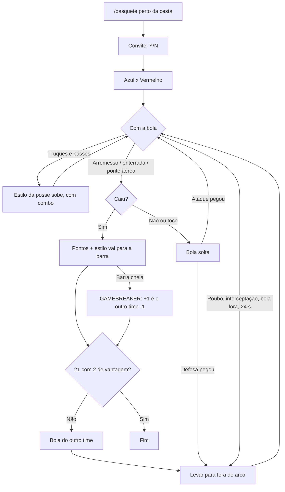

# Basquete coop: esquema

Partida de basquete de rua entre jogadores do grupo, em qualquer cesta do mapa: 1x1, 2x2 ou 3x3, no estilo do
**NBA Street**. Tem drible, crossover, giro, firula, finta, passe, ponte aérea, roubo, toco, quebrar o tornozelo,
turbo, estilo com combo, Gamebreaker, relógio de 24 s e placar na tela. O minigame original do GTA continua existindo
para quem joga sozinho.

## 1. Como uma partida começa

1. Perto de uma cesta (até 25 m), alguém digita **`/basquete`** no chat. Variações:
   - `/basquete 11`: joga até 11 (qualquer número de 5 a 31; o padrão é 21, como no NBA Street);
   - `/basquete nba` ou `/basquete nba 15`: regras da NBA (2 e 3 pontos);
   - `/basquete treino`: treino sozinho.
2. Quem está a até 30 m recebe o convite e aceita com **Y** (recusa com **N**), como nos outros convites do mod.
3. Depois de 15 s (ou quando todos responderem), os times são montados na ordem de entrada: azul, vermelho, azul...
   Com 2 jogadores é 1x1, com 4 é 2x2 e com 6 é 3x3. Número ímpar: o último fica de fora e assiste.
4. O jogo de quem digitou `/basquete` é o **juiz**: ele guarda o placar oficial, as barras de Gamebreaker e o relógio,
   e resolve disputas.
5. Começa com a bola do time vermelho.

## 2. Regras

| Regra | Como fica |
|---|---|
| Pontos (rua, padrão) | 1 de dentro do arco, 2 de fora (arco a 6 m do aro). Enterrada vale 1 |
| Pontos (`nba`) | 2 de dentro, 3 de fora. Enterrada vale 2 |
| Fim | Quem chegar primeiro ao alvo (21 ou o escolhido) **com 2 de vantagem** |
| Depois de cesta | A bola vai para o outro time, para quem estiver mais perto do topo do garrafão |
| Limpar a bola | Depois de cesta, rebote defensivo, roubo ou interceptação, o time leva a bola para fora do arco antes de arremessar. A tela avisa, e um arremesso sem limpar não vale |
| Relógio | 24 s para arremessar. Zera a cada troca de posse e a cada rebote. Estourou: bola do outro time |
| Bola fora | A mais de 12 m do aro ou atrás da tabela, a posse passa para o outro time |
| Estilo | Cada truque e passe especial soma estilo na posse. Truques seguidos (até 3 s um do outro) multiplicam: x2, x3, até x5. Repetir o mesmo truque na mesma posse rende menos. O estilo só vai para a barra do time quando a cesta cai; perder a bola perde o estilo |
| Gamebreaker | Barra cheia (1000): a próxima cesta do time vale +1 e tira 1 ponto do outro time. A barra zera |
| Sair | `/basquete sair`. Se alguém sair ou cair, a partida segue com quem ficou e acaba se um time ficar vazio |

## 3. Controles (padrão do GTA no PC)

`/basquete comandos` mostra esta lista num quadro no meio da tela (de novo para fechar). Durante a partida, o soco, o
pulo, o agachar e a troca de arma do GTA ficam desligados, porque essas teclas viram as do basquete.

**Com a bola**

| Ação | Tecla | O que acontece |
|---|---|---|
| Driblar | W A S D | As animações de basquete do jogo andam com o CJ, virado para onde o direcional aponta |
| Correr (turbo) | Segurar **Espaço** | Corre gastando a barra de turbo. Vazia, só anda até encher um quarto |
| Arremessar | **Botão esquerdo** | Segure para pular e solte na marca, ou toque para pular e toque de novo na marca |
| Cancelar o arremesso | **C** no ar, antes de soltar | O CJ desce com a bola (a finta dupla) |
| Enterrar | **Botão esquerdo** correndo, de frente para o aro | Até 3,5 m. Com turbo, de até 5,5 m (enterrada de longe, gasta turbo) |
| Crossover | **Shift** andando ou correndo | Troca de mão com um tranco de lado. Pode quebrar o tornozelo de quem está na frente |
| Giro (spin) | **Shift** correndo com **Espaço** | Uma volta inteira, saindo um pouco de lado. Mais estilo e mais chance de quebrar o tornozelo. Gasta turbo |
| Firula | **Shift** parado | Os dribles de exibição do jogo. Estilo, mas é a hora mais fácil de levar um roubo |
| Finta de arremesso | **C** | Começa o pulo e desiste. Se um defensor pular para dar toco, é "Fintou!" (mais estilo) |
| Passe | **Botão direito** | Para o colega mais alinhado com a câmera. Sem colega (1x1, treino): tabela para você mesmo |
| Passe especial | **Botão direito + Espaço** | Ponte aérea para o colega perto do aro; senão, de quicar na cabeça do defensor da frente; senão, tabela |

**Sem a bola**

| Ação | Tecla | O que acontece |
|---|---|---|
| Roubar | **Botão esquerdo** a até 1,6 m de quem está com a bola | O jogo dele decide pelo que ele está fazendo: firula ou começo de truque 55%, parado 30%, andando 22%, correndo 12%. Arremesso e enterrada não dá |
| Toco | **Shift** | Pulo de defesa. Pegando quem arremessa ou enterra perto e na hora, a bola sai desviada |
| Tapinha / enterrada de rebote | **Shift** perto do aro num arremesso errado | Pega a bola no alto. Se for do time que arremessou, já sobe enterrando |
| Postura de defesa | Segurar o **botão direito** | De frente para a bola. A e D dão passos de lado. Na postura, o tornozelo quebra com metade da chance |
| Pegar bola solta, rebote ou interceptar | Encostar nela | Quem chega primeiro no juiz leva. Um passe que passa perto do defensor pode ser interceptado |

## 4. Chances

**Arremesso.** A chance começa pela distância até o aro: até 2,5 m é 75%, cai até 55% aos 6 m, e de fora do arco
começa em 40% e perde 4% por metro. Depois muda com o tempo da soltura (o ponto alto é 40% do pulo, como no original):

- **Perfeito** (até 0,03 do ponto): +20% e estilo
- **Bom** (até 0,07): igual
- **Ruim:** −35%
- **Sem soltar:** −45%
- **Marcado** (defensor a até 1,4 m na frente): −15%

**Toco.** Vale o pulo de um defensor nos últimos 0,8 s, a até 1,9 m e não atrás de quem arremessa: 60% num arremesso,
45% numa enterrada, 35% numa ponte aérea.

**Tornozelo.** No meio do crossover (22%) ou do giro (32%), contra o defensor mais perto na frente (até 2,4 m). O combo
soma 5% por nível. Na postura de defesa é metade; no ar, nunca. Quem cai fica uns 2 s no chão.

**Estilo de cada truque:** crossover 60, giro 90, firula 40, finta 30, fintou 80, tornozelo 150, tabela 120, na cabeça
160, ponte aérea 150 (para quem passa e para quem enterra), enterrada 60, enterrada de longe 120, de rebote 100,
soltura perfeita 40.

## 5. Tela

- Placar no topo: **AZUL 7 x 5 VERMELHO · até 21**, com quem está com a bola e o relógio da posse.
- Embaixo do placar, as barras de Gamebreaker dos dois times (piscam quando cheias) e os truques dos outros.
- Embaixo: as teclas, a barra de turbo e o estilo da posse com o combo.
- Barra de tempo do arremesso; o nome de cada truque seu no meio da tela.
- Avisos grandes: cesta, enterrada, ponte aérea, GAMEBREAKER, toco, roubo, interceptação, tornozelo, 24 s, bola fora.

## 6. Rede

Tudo vai na mensagem `G_BASKET` (178), repassada pelo servidor a todos. Cada uma começa pela operação e o número da
partida.

| Operação | Quem manda | Conteúdo |
|---|---|---|
| 1 convite / 2 resposta | Quem convida / quem responde | A cesta, o alvo de pontos e as regras / sim ou não |
| 3 início | Juiz | Cesta, alvo, regras, times e quem começa com a bola |
| 4 estado | Juiz | Placar, posse, quem precisa limpar, o evento para a tela, as barras de Gamebreaker e o relógio |
| 5 arremesso | Quem arremessa ou enterra | De onde, se caiu, se foi toco (e de quem), ponte aérea, a semente da trajetória, pontos e estilo |
| 9 passe | Quem passa | Tipo, para quem, de onde, por onde (tabela, cabeça), para onde, tempos, semente e o estilo que vai junto |
| 6 pedido da bola | Quem encosta numa bola solta ou passada | O juiz dá para o primeiro |
| 10 truque | Quem faz | Para mostrar na tela dos outros |
| 11 tornozelo | Quem driblou | Quem cai (o jogo dele derruba o CJ dele) |
| 12 roubo / 13 resposta | Quem tenta / quem está com a bola | O jogo de quem está com a bola decide; o juiz passa a posse |
| 14 pulo de toco | Quem pula | Os outros jogos guardam a hora para conferir o toco e a finta |
| 7 saída / 8 fim | Quem sai / juiz | — / placar final |

O juiz só aceita arremesso ou passe de quem está com a bola (ou de quem recebe a ponte aérea no ar). Todos os jogos
tocam a mesma trajetória a partir da semente, então todos veem a mesma bola sem mandar a posição dela.

## 7. O que o jogo já tem (pesquisado no `gta_sa.exe` e nos scripts)

- **Cestas:** os modelos `BSKBALL_LAX`, `BSKBALLHUB_LAX01`, `VGSXREFBBALLNET` e `VGSXREFBBALLNET2`. O ponto do aro é a
  "level design coord" 0 do objeto (`GET_LEVEL_DESIGN_COORDS_FOR_OBJECT`), e o mod acha a cesta mais perto na hora.
- **Bola:** `BBALL_INGAME` é a bola animada na mão, com animações próprias `*_O` que seguem as do CJ no mesmo tempo.
- **Animações (bloco `BSKTBALL`):** `IDLE`, `IDLE2`, `IDLELOOP`, `WALK`, `WALKSTOP_L/R`, `RUN`, `SKIDSTOP_L/R`, `PICKUP`,
  `JUMP_SHOT`, `JUMP_CANCEL`, `DNK_LNCH`, `DNK_GLI`, `DNK`, `DNK_LND`, `REACT_SCORE`, `REACT_MISS`, `DEF_LOOP`,
  `DEF_STEPL/R` (passo de lado de 0,7 m) e `DEF_JUMP_SHOT`, todas com o prefixo `BBALL_`. Os passes usam os
  arremessos do bloco `GRENADE` (`WEAPON_throwu`, `WEAPON_throw`), e o tornozelo quebrado usa `KD_left/right` e
  `getup` do bloco `PED`.
- **Enterrada:** o original prende o CJ num objeto invisível que voa até o aro (`ATTACH_CHAR_TO_OBJECT`), e isso joga a
  câmera para a primeira pessoa. O mod faz o mesmo caminho congelando o CJ e colocando ele no lugar a cada quadro, então
  a câmera continua a do jogador.
- **Minigame original:** o script `BBALL` (`basketb.scm`, no `script.img`) roda como "cérebro" das cestas. Durante a
  nossa partida ele fica desligado: o mod segura a variável que ele confere no começo (`$7712`).

## 8. O que o NBA Street tem e não deu para trazer

- **Truques no ar e dribles por trás das costas, entre as pernas com toque, etc.:** o GTA não tem essas animações. Os
  truques usam as que existem (crossover com o tranco do `SKIDSTOP`, giro, firula com os dribles parados).
- **Ponte aérea pegando a bola no ar de qualquer lugar:** o recebedor precisa estar a até 7,5 m do aro, na frente da
  tabela.
- **Empurrão, enterrada com Gamebreaker especial e câmera lenta:** ficaram de fora.

## 9. Fases

| Fase | O que entra |
|---|---|
| **1. Base** (1.20.0 a 1.20.2) | Treino e partida com convite, drible, arremesso com barra, enterrada, rebote, limpar a bola, bola fora, placar, lista de comandos |
| **2. NBA Street** (1.21.0) | Câmera em terceira pessoa na enterrada; regras de rua (21, 1 e 2, vantagem de 2) e `nba`; turbo; crossover, giro, firula, finta e cancelamento; passe, ponte aérea, tabela e na cabeça; roubo, toco, tapinha, postura, marcação; tornozelo; estilo com combo; Gamebreaker; relógio de 24 s; comemoração |
| **3. Extras** | Sons (rede, aro, torcida), estatísticas no fim, ranking guardado entre partidas. O que o grupo pedir |

## 10. Como testar

- **Sozinho:** `/basquete treino` numa cesta, como a da Grove Street. Testa drible, truques, arremesso, enterrada (a
  câmera tem que ficar a sua), tabela para você mesmo (botão direito) e a barra de Gamebreaker.
- **Em 2 ou mais:** `/basquete`, os amigos aceitam com Y. Testar roubo, toco, finta, tornozelo, passe e ponte aérea, e
  conferir se o placar e a bola são iguais em todas as telas.
- **Logs:** o `coop.log` ganha linhas `Basketball: ...` (a cesta achada, cada arremesso com distância, soltura e
  marcação, tocos, roubos com a chance, passes, enterradas, tornozelos, o fim).

## 11. Código

- `src/client/features/basketball/Basketball.cpp`: convite, juiz, movimentos com e sem a bola, bola e tela.
- `src/client/features/basketball/BallPath.cpp`: a chance e as trajetórias (arremesso, passe, tabela, toco), puras e
  iguais em todos os jogos. Teste: `tools/basketball/path_test.cpp` (3.000 arremessos e 2.000 passes: a bola chega
  onde deve, nada atravessa o chão, o rebote fica na quadra).
- Mensagem de rede: `G_BASKET` (178) em `src/common/api/protocol/Protocol.h`.
